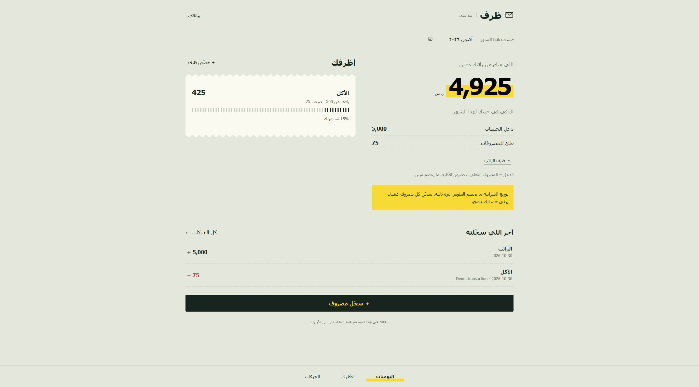
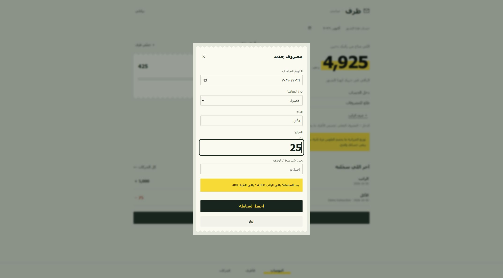
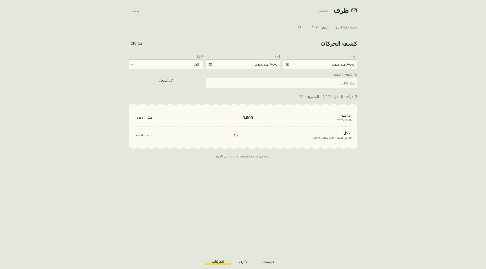

# Zarf — Personal Budget Management System

A mobile-friendly envelope budgeting app with an Arabic, right-to-left interface. Track income, record expenses, and see what remains in each monthly budget. The visual design draws on paper receipts, muted sage backgrounds, and yellow highlights.

**[Open the live app](https://ghazalalsharif.github.io/Personal-Budget-Management-System/)** · **[Open in VS Code for the Web](https://github.dev/ghazalalsharif/Personal-Budget-Management-System)** · [Original Windows desktop project](README-desktop.md)

## Screenshots

Actual screenshots of the web app using fictional test transactions. The application interface is Arabic; repository documentation and code comments are in English.

### Desktop overview

Monthly income, recorded expenses, available balance, and envelope consumption in one view.



### Expense entry

Preview the remaining salary and envelope balance before saving.



### Transaction ledger

Filter, review, edit, and export recorded income and expenses.



## Features

- **Income and salary tracking:** record received income and calculate the monthly balance.
- **Monthly envelopes:** allocate a budget per category and track spending, remaining funds, and overspending.
- **Transaction management:** add, edit, delete, and search by date range, type, category, or description.
- **Live expense preview:** see the projected balance before saving a transaction.
- **Local data storage:** keep records in the current browser without an application backend.
- **Data portability:** export and restore JSON backups, import `budget.xml` from the desktop version, and export filtered transactions to CSV.
- **Mobile support:** responsive RTL layouts, a web app manifest, and a service worker for cached offline access after the first successful load.

## How the balances work

Budget allocation is a plan, not a transaction. It does **not** deduct money from income a second time.

| Example | Calculation | Result |
| --- | --- | --- |
| Available salary | SAR 5,000 income − SAR 50 expenses | SAR 4,950 |
| Food envelope balance | SAR 500 allocated − SAR 50 spent | SAR 450 |
| Food envelope consumption | SAR 50 ÷ SAR 500 × 100 | 10% |

Amounts are stored as integer halalas (1 SAR = 100 halalas) to avoid floating-point rounding errors. The app displays Saudi riyals and does not perform currency conversion. Each monthly summary includes transactions from that calendar month; there is no automatic balance carryover.

## Run locally

Requires **Node.js 20 or later**. The web app has no third-party runtime dependencies and needs no build step.

```bash
git clone https://github.com/ghazalalsharif/Personal-Budget-Management-System.git
cd Personal-Budget-Management-System
npm start
```

Open **http://127.0.0.1:4173** and leave the terminal running. Use this local server instead of opening `index.html` directly: the app uses JavaScript modules and a service worker.

### In Visual Studio Code

1. Open the repository folder with **File → Open Folder**.
2. Edit `docs/index.html`, `docs/style.css`, `docs/app.js`, or `docs/core.js`.
3. Open **Terminal → New Terminal** and run `npm start`.
4. Open the local URL in a browser. Reload after saving code changes.

The `.vscode` folder includes tasks for starting the server and running tests, plus an Edge debugging configuration. Start the server before using the debugger. VS Code for the Web can edit repository files; local Node.js commands require desktop VS Code or another development environment.

## Tests and verification

```bash
npm test
```

The 10 automated tests cover decimal parsing, invalid input, category normalization, envelope arithmetic, overspending, monthly isolation, filtering, storage failures, and CSV escaping. Browser checks also verified salary entry, envelope allocation, expense entry, editing, search, and persistence after reloading at a mobile viewport.

Screenshots were captured from the local web app. Browser checks are not an automated end-to-end suite. Offline behavior and installation prompts can vary by browser and device.

## Project structure

```text
docs/                    Public web app served by GitHub Pages
  index.html             Page structure and accessible form labels
  style.css              Responsive receipt-inspired visual design
  app.js                 UI events, rendering, imports, and persistence
  core.js                Validation, integer-money calculations, filters, CSV
  sw.js                  Same-origin static asset caching
  manifest.webmanifest   Web app launch metadata
assets/screenshots/      Documentation images with fictional test data
tests/core.test.mjs       Node.js unit tests
server.mjs               Local development server (loopback only)
.vscode/                 Editor tasks and debugging configuration
README-desktop.md        Documentation for the original C# application
*.cs, *.sln, *.csproj     Retained Windows Forms coursework source
```

The web app is the current browser/mobile version. The C# source is retained for the original desktop project and is not required to run the website.

## Data storage and privacy

- Records are stored in `localStorage` under `zarf-budget-v1`; financial records are not sent to an application server or committed to GitHub.
- Each browser/device has separate data. There are **no accounts or automatic cross-device synchronization**.
- Clearing site data, private browsing, or browser storage limits may remove or prevent saving records. Export a backup regularly using the in-app data menu.
- Importing a backup replaces the current browser's records after confirmation. The existing stored payload is retained in a previous-version key when storage allows.
- Local storage is not an encrypted vault. Anyone with access to the browser profile may be able to read its records.
- The service worker caches app files; it does not back up financial records. Offline access requires a successful initial load and retained browser caches.

To move desktop records to a phone, transfer your `budget.xml` file privately and import it through the app's data menu. Never add real financial data, exported backups, or credentials to this public repository.

## Deployment

GitHub Pages serves **`main` → `/docs`**. Push changes to that folder to update the app; no build pipeline or paid hosting service is required. Documentation screenshots live outside `docs/` so they are not part of the app's offline asset bundle.

On a phone, open the live URL and use the browser's **Add to Home Screen** option if available. The application can be used directly in the browser without installation.

## Technology

HTML · CSS · JavaScript ES modules · Web Storage · Service Worker · Node.js test runner · GitHub Pages

Original desktop version: C# · Windows Forms · .NET Framework 4.7.2.

## Author

[Ghazal Alsharif](https://github.com/ghazalalsharif) · [Portfolio](https://ghazalalsharif.github.io/Portfolio-Website/)
